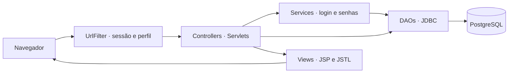

<div align="center">


### O estoque no ritmo das suas vendas.

Gestão de estoque, organização de lojas e controle de promoções em uma aplicação Java Web.


[Sobre](#sobre-o-projeto) · [Funcionalidades](#funcionalidades) · [Como executar](#como-executar) · [Arquitetura](#arquitetura) · [Equipe](#equipe)

</div>

---

## Sobre o projeto

O **QuiStock** é um projeto interdisciplinar voltado à gestão de estoque no varejo de alimentos. Sua proposta é ajudar a organizar produtos, acompanhar quantidades e datas de validade e apoiar decisões que contribuam para reduzir desperdícios.

Este repositório reúne a aplicação web: backend em **Java**, persistência em **PostgreSQL** e interface com **HTML, CSS, JavaScript e JSP**. A experiência inclui uma landing page de apresentação, autenticação e telas de gerenciamento para a operação.

O escopo implementado concentra-se nos cadastros e no gerenciamento de estoque, pedidos e promoções. Integração com ERP/SAP, previsões e alertas automáticos fazem parte da proposta apresentada na landing page; este repositório não fornece implementações desses serviços.

## Funcionalidades

| Módulo | O que é possível fazer |
| --- | --- |
| **Autenticação** | Entrar com uma conta de administrador ou gerente regional e acessar a área interna por sessão. |
| **Administradores** | Cadastrar, consultar, editar e excluir administradores, em rotas reservadas ao perfil `ADMIN`. |
| **Gerentes regionais** | Gerenciar contas de gerentes e sua associação com regiões, em rotas reservadas ao perfil `ADMIN`. |
| **Regiões** | Organizar as regiões utilizadas pelos cadastros de lojas e gerentes. |
| **Lojas** | Cadastrar e atualizar lojas, seus e-mails, senhas e vínculos com regiões. |
| **Produtos** | Gerenciar lote, nome, preço, validade, marca, linha, quantidade em estoque e loja associada. |
| **Pedidos** | Registrar e gerenciar pedidos associados a produtos, com data e valor total. |
| **Promoções** | Registrar e gerenciar descontos percentuais, produtos e prazo de validade da promoção. |
| **Interface** | Navegar por telas responsivas, formulários em modais, mensagens de validação e páginas de erro personalizadas. |

Novas senhas cadastradas pela aplicação são armazenadas com **bcrypt**. As operações de banco utilizam **JDBC** e parâmetros em `PreparedStatement`.

## Tecnologias

| Camada | Tecnologias |
| --- | --- |
| Linguagem | Java 21 |
| Aplicação web | Jakarta Servlet API 6.1, JSP e JSTL |
| Interface | HTML5, CSS3 e JavaScript |
| Persistência | PostgreSQL e JDBC |
| Autenticação | Sessões HTTP e bcrypt |
| Configuração | Variáveis de ambiente e `dotenv-java` |
| Build | Maven Wrapper e empacotamento WAR |
| Código auxiliar | Lombok |

As versões das dependências estão definidas no [`pom.xml`](pom.xml).

## Como executar

### 1. Prepare o ambiente

- **JDK 21**, com `JAVA_HOME` configurado.
- **Git** para clonar o repositório.
- **PostgreSQL** acessível, com o esquema da aplicação já criado.
- Um servidor compatível com **Jakarta Servlet 6.1**, como **Apache Tomcat 11**, conforme a [matriz oficial de compatibilidade](https://tomcat.apache.org/whichversion.html).

O Maven Wrapper está incluído no projeto, portanto não é necessário instalar o Maven separadamente.

### 2. Clone o repositório

```bash
git clone https://github.com/QuiStock/back_quistock_primeiro.git
cd back_quistock_primeiro
```

### 3. Prepare o banco de dados

A aplicação espera encontrar um banco compatível com as consultas da camada [`DAO`](src/main/java/DAO), incluindo as tabelas `super_admin`, `regional_manager`, `region_type`, `store`, `product` e `suggestion`, além da view `suggestions_vw`.

**A branch `main` não inclui os scripts SQL de criação nem migrações automáticas.** Obtenha com a equipe os scripts correspondentes à versão atual antes da primeira execução. O banco não é criado pelo build ou pela inicialização da aplicação.

Também é necessário provisionar uma conta inicial de administrador no banco. Não há cadastro público de usuários ou credenciais padrão distribuídas neste README. Gere o hash da senha com `PasswordService.genHash` e utilize-o no provisionamento da conta.

### 4. Configure a conexão

Copie o arquivo [`.env.example`](.env.example) para `.env`.

**Windows — PowerShell:**

```powershell
Copy-Item .env.example .env
```

**Linux ou macOS:**

```bash
cp .env.example .env
```

Preencha os valores com as configurações do seu ambiente:

```dotenv
url=jdbc:postgresql://localhost:5432/quistock
user=SEU_USUARIO
password=SUA_SENHA
```

Os nomes **`url`**, **`user`** e **`password`** são utilizados exatamente assim, em letras minúsculas, pela [`ConnectionFactory`](src/main/java/DAO/ConnectionFactory.java). O exemplo acima é ilustrativo; ajuste host, porta, banco e opções de conexão conforme o PostgreSQL utilizado.

O `.env` deve estar no **diretório de trabalho do processo que executa o servidor**. Na configuração da IDE, defina esse diretório como a raiz do projeto. Outra opção é fornecer as três variáveis diretamente ao processo do Tomcat.

O `.env` é uma configuração local ignorada pelo Git. Mantenha credenciais reais fora dos arquivos versionados e do pacote de distribuição.

### 5. Gere o WAR

**Windows:**

```powershell
.\mvnw.cmd clean package
```

**Linux ou macOS:**

```bash
./mvnw clean package
```

O artefato gerado é `target/demo-1.0-SNAPSHOT.war`.

### 6. Publique no Tomcat

Com o Tomcat parado, copie o WAR para o diretório `webapps` da instalação. Inicie o servidor com as variáveis de conexão ou o diretório de trabalho configurados no passo anterior.

Mantendo o nome original do WAR e a porta padrão, abra:

```text
http://localhost:8080/demo-1.0-SNAPSHOT/
```

A raiz abre a apresentação do QuiStock. Use **Login** para acessar a área interna com uma conta provisionada no banco.

Se utilizar o IntelliJ IDEA com suporte a servidor de aplicações, configure o **JDK 21**, adicione o **Tomcat**, selecione o artefato **WAR** ou **WAR exploded** em *Deployment* e ajuste o *Application context*. O caminho de acesso acompanha o contexto escolhido.

## Primeiro passeio pela aplicação

1. Entre com uma conta de administrador.
2. Cadastre uma região para organizar as lojas e os gerentes.
3. Cadastre uma loja vinculada à região.
4. Adicione produtos com lote, validade, preço e quantidade em estoque.
5. Registre pedidos e promoções vinculados aos produtos cadastrados.
6. Cadastre gerentes regionais e outros administradores conforme a necessidade da demonstração.

## Arquitetura

O projeto segue a organização **MVC**, com uma camada de serviços para autenticação e tratamento de senhas e uma camada **DAO** para persistência.



Os servlets recebem as requisições, validam os dados e coordenam as operações. As classes de modelo representam os dados, os DAOs executam as consultas e as páginas JSP apresentam os resultados ao usuário.

### Organização dos arquivos

```text
back_quistock_primeiro/
├── .mvn/wrapper/             # Configuração do Maven Wrapper
├── src/main/
│   ├── java/
│   │   ├── Controller/      # Servlets e filtro de acesso
│   │   ├── DAO/             # Conexão e operações no PostgreSQL
│   │   ├── Model/           # Entidades e usuário autenticado
│   │   └── Service/         # Autenticação e senhas
│   ├── resources/           # Recursos da aplicação
│   └── webapp/
│       ├── WEB-INF/views/   # Views internas e menu compartilhado
│       ├── assets/          # Ícones, imagens e scripts auxiliares
│       ├── css/             # Estilos das páginas
│       ├── landing-assets/  # Identidade visual e imagens da apresentação
│       ├── script/          # Scripts da interface
│       ├── index.html       # Landing page
│       └── login.jsp        # Entrada para a área interna
├── .env.example             # Modelo de configuração
├── mvnw / mvnw.cmd          # Executáveis do Maven Wrapper
├── pom.xml                  # Dependências e build
└── LICENSE                  # Licença MIT
```

### Rotas principais

As rotas abaixo são relativas ao contexto da aplicação.

| Rota | Destino |
| --- | --- |
| `/` | Landing page |
| `/login.jsp` | Formulário de autenticação |
| `/login` | Processamento do login via `POST` |
| `/inicio` | Página inicial da área autenticada |
| `/admins` | Administradores |
| `/regionalManagers` | Gerentes regionais |
| `/regioes` ou `/regionTypes` | Regiões |
| `/stores` | Lojas |
| `/products` | Produtos |
| `/orders` | Pedidos |
| `/sales` | Promoções |

## Solução de problemas

| Situação | O que conferir |
| --- | --- |
| `URL and User/Password are mandatory` | Confirme as três variáveis em minúsculas e o diretório de trabalho em que o Tomcat procura o `.env`. |
| Falha ao conectar ao PostgreSQL | Confira a URL JDBC, as credenciais, a disponibilidade do servidor e as exigências de SSL do provedor. |
| Tabela ou view inexistente | Aplique os scripts de banco compatíveis com a aplicação, incluindo `suggestions_vw`. |
| Login recusado | Confirme que a conta existe em `super_admin` ou `regional_manager` e que a senha corresponde à cadastrada. |
| Erro de compilação relacionado ao Java | Confira se o Maven está executando com JDK 21: `java -version` e `.\mvnw.cmd -version` no Windows ou `./mvnw -version` no Linux/macOS. |
| Página não encontrada após o deploy | Confira o nome do WAR, o contexto configurado e os logs de inicialização do Tomcat. |

## Equipe

Desenvolvido pela equipe **QuiStock** como projeto interdisciplinar, reunindo modelagem de dados, desenvolvimento Java Web e construção de interfaces.

[Conheça os contribuidores do repositório](https://github.com/QuiStock/back_quistock_primeiro/graphs/contributors).

## Licença

Distribuído sob a **licença MIT**. Consulte o arquivo [LICENSE](LICENSE).

---

<div align="center">

**QuiStock — O estoque no ritmo das suas vendas.**

</div>
